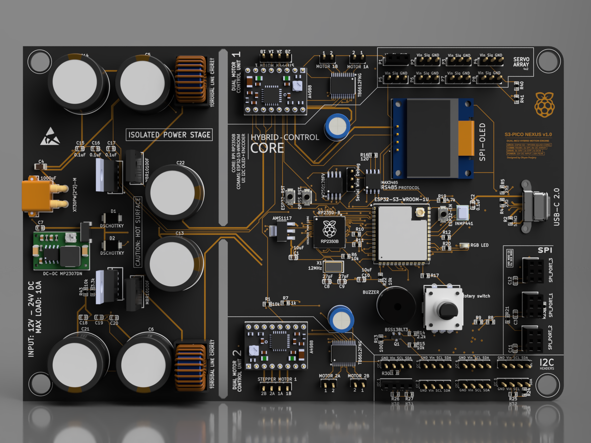

# Hi, I'm Dhyan

**Embedded systems and hardware engineer** | Final-year ECE @ BMSCE, Bengaluru

I design custom PCBs and write the firmware that runs on them: from schematic and layout to
bring-up, sensor/actuator interfacing, CAN/LoRa networking, and testing. ECAD intern at
**U R Rao Satellite Centre (ISRO)**, VP of **ELSOC** (BMSCE Electronics Society), and
2nd place nationally at **Solar Decathlon India 2025–26** (Team Amara).

Bengaluru, India
Looking for full-time embedded firmware / hardware roles (graduating 2027)

---

## Featured projects

| Project | What it is | Stack |
|---|---|---|
| [**RISC-V Motorsport VCU & Telemetry**](https://github.com/kfcnode/REPO-NAME) | Modular VCU firmware (sensing, state estimation, safety monitor, control) with a CAN → Raspberry Pi → LoRa → ground station telemetry pipeline, a Wi-Fi video link, and fail-safe/E-stop logic | RISC-V, C, CAN, RPi 4B, LoRa, Python |
| [**S3-PICO NEXUS**](https://github.com/kfcnode/REPO-NAME) | Dual-MCU robotics controller on a custom 4-layer PCB: 8 servos, 4 DC motors, 2 steppers, 12–24V multi-rail power | RP2350B, ESP32-S3, KiCad |
| [**Binary Watch**](https://github.com/kfcnode/REPO-NAME) | Fabricated binary wristwatch PCB with RTC, running on a CR2032 | ATmega328P, DS3231, KiCad/EasyEDA |
| [**Verilog Ethernet MAC**](https://github.com/kfcnode/REPO-NAME) | Ethernet MAC with an FSM, CRC-32, and TX/RX verified in simulation | Verilog, Vivado |
| [**Embedded C Drivers**](https://github.com/kfcnode/REPO-NAME) | Register-level GPIO, UART (ISR + ring buffer), I2C, SPI, and state machines, no libraries | C, ATmega328PB |
| [**PCB Design Portfolio**](https://github.com/kfcnode/REPO-NAME) | Collection of boards: eval boards, differential pairs, multi-layer designs | KiCad, Allegro |

---

## Tech stack

| | |
|---|---|
| **Languages** | Embedded C, C, Python, Verilog, VHDL |
| **MCUs / Platforms** | ESP32, ESP32-S3, RP2350B, RISC-V, STM32, ATmega328P, Raspberry Pi |
| **Protocols** | CAN, I2C, SPI, UART, RS-485, I2S, USB, LoRa, BLE, Wi-Fi |
| **EDA / Tools** | Cadence Allegro, OrCAD, KiCad, EasyEDA, Vivado, MATLAB/Simulink, SPICE |

---

## Highlights

- 🥈 2nd place nationally, Solar Decathlon India 2025–26
- 🥈 Runner-up, RoboManthan hardware hackathon (Nov 2025)
- 🥇 Winner, Arduino Bootcamp 2024, BMSCE
- 🛰️ ECAD intern, ISRO URSC: 4-layer flight PCB, and PDN/impedance work on a 16-layer board

---

## Reach me

[LinkedIn](https://linkedin.com/in/dhyan-poojary) · [Email](mailto:dhyanpoojary95@gmail.com)

